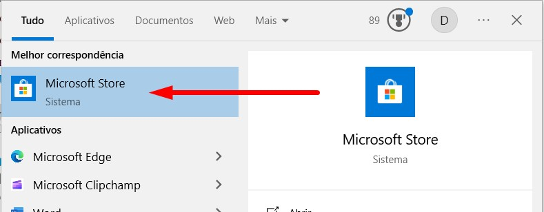
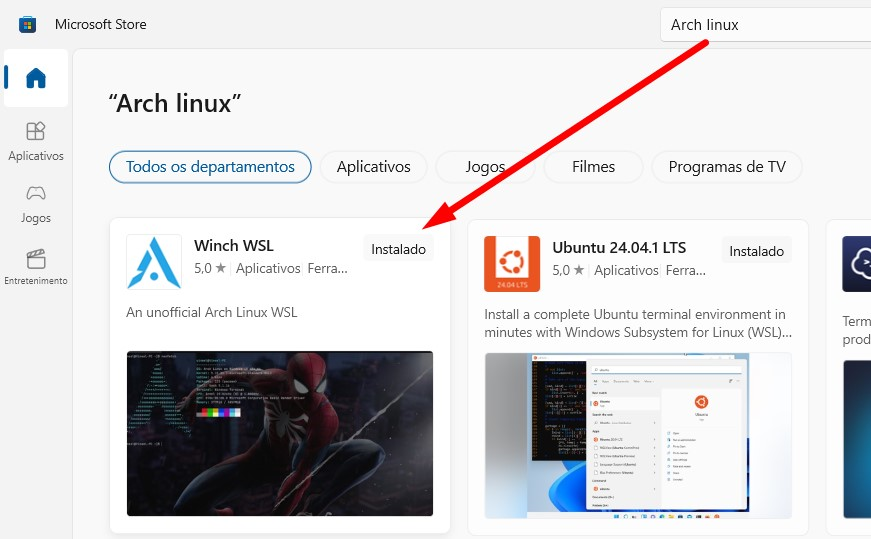
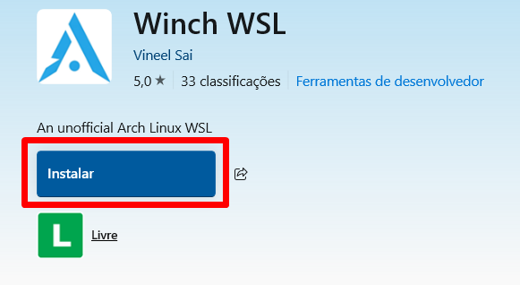
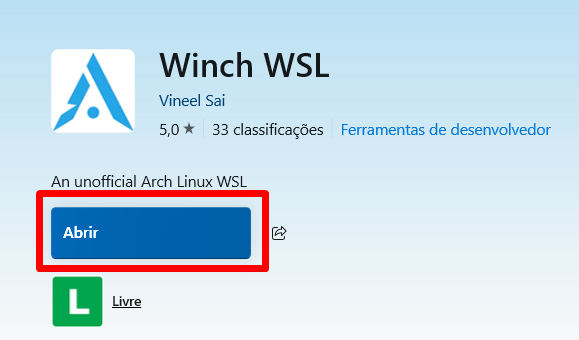
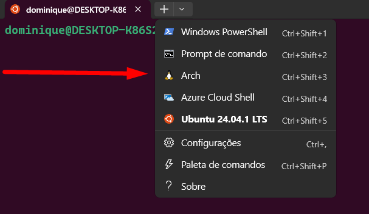
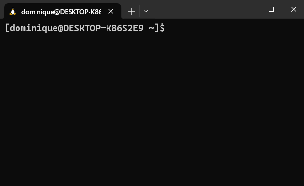
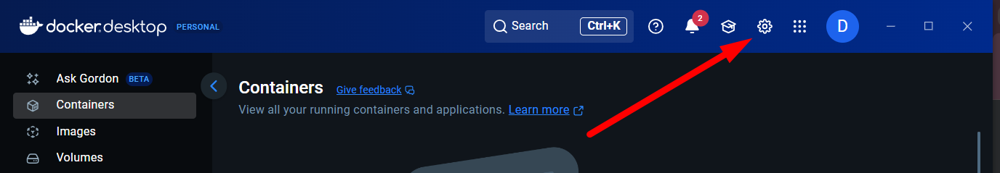
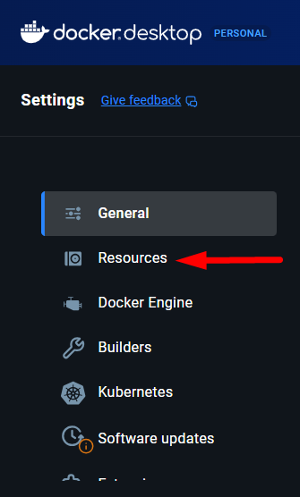
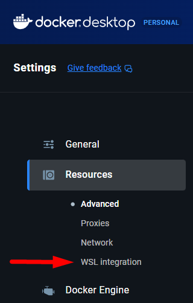
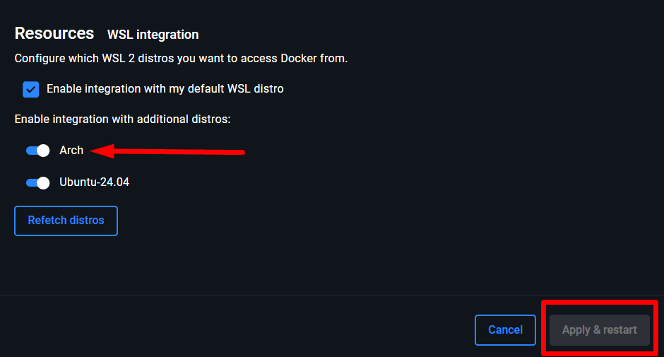

# WINDOWS -

# SETUP DO RUBY ON RAILS NO ARCH LINUX

## Esse setup engloba:

### 1º) Parte 1 - A instalação do Arch Linux no WSL

### 2º) Parte 2 - A instalação do Git, Ruby, RVM, PostgreSQL e Ruby on Rails no sistema Operacional em questão.

<br>

## Parte 1 - Instalação do Arch Linux

### 1º - Instalando o Arch Linux no WSL (Subsistema Windows para Linux)

**Observação**: Para que você possa realizar a instalação do Arch Linux é necessário que você já tenha o WSL instalado na sua máquina. Caso ainda não tenha, <a href="https://www.youtube.com/watch?v=Kumk-nRDPB8" target="_blank" rel="noopener">clique aqui</a> para acessar o tutorial de instalação deste.

Busque pela 'Microsoft Store' no seu menu iniciar:

<div align="center">

</div>
<br>
<br>
Depois busque por 'Arch Linux' no buscador da loja e selecione a opção abaixo:
<br>
<br>
<div align="center">

</div>
<br>
<br>
Então, clique em 'Instalar' e aguarde.
<br>
<br>
<div align="center">

</div>
<br>
<br>
<br>
Depois que terminar a instalação o botão 'Abrir' ficará habilitado. Clique nele. 
<br>
<br>
<br>
<div align="center">

</div>
Abrirá em sua tela então o terminal próprio do Arch Linux onde será realizado o final do processo de instalação (aguarde).
<br>
<br>
Abra então o Terminal do WSL e selecione o Arch Linux neste:
<br>
<br>
<div align="center">

</div>
<br>
Pronto! Ali estará o seu Arch Linux pronto para começar a usar!
<br>
<br>
<div align="center">

</div>
<br>

### Parte 2 - A instalação do Git, Ruby, RVM, PostgreSQL e Ruby on Rails no sistema operacional em questão.

<br>

### Instalando o GIT (Versionador de Código):

Insira o comando:

```bash
sudo pacman -S git -y
```

... no terminal do Arch Linux no WSL.

Para checar se a instalação foi realizada com sucesso digite no termial:

```bash
git --version
```

Isso vai mostrar a versão do git que foi instalada na máquina.
Fonte: <a a href="https://analyticalnahid.medium.com/how-to-install-git-and-github-desktop-in-arch-linux-bb70c56751d8" target="_blank" rel="noopener">Nahidul Islam (site: Medium)</a>

<br>

### Instalando o RVM (Gerenciador de Versões do Ruby):

Para instalar o RVM é necessário antes instalar as chaves GPG (rode o comando a seguir no terminal para fazê-lo):

```bash
gpg2 --keyserver keyserver.ubuntu.com --recv-keys 409B6B1796C275462A1703113804BB82D39DC0E3 7D2BAF1CF37B13E2069D6956105BD0E739499BDB
```

Depois, instale o RVM com o comando:

```bash
\curl -sSL https://get.rvm.io | bash -s stable
```

Depois de instalado, é possivel que o terminal exiba a seguinte orientação:

> _To start using RVM you need to run 'source /home/seu-usuario/.rvm/scripts/rvm' in all your open shell windows, in rare cases you need to reopen all shell windows_.

**Traduzindo para o português**: Para começar a usar o RVM, você precisa executar 'source /home/seu-usuario/.rvm/scripts/rvm' em todas as suas janelas de terminal abertas. Em casos raros, talvez seja necessário reabrir todas as janelas do terminal.

Rode o comando na pasta onde ficarão os seus projetos do Ruby.
E depois insira no terminal o comando:

```bash
rvm -v
```

Para ver qual versão do RVM foi instalada em sua máquina.

Fonte: <a a href="https://rvm.io/" target="_blank" rel="noopener">Site oficial do RVM (rvm.io)</a>

<br>

### Instalando o Ruby:

Para instalar precisamente uma determinada versão do Ruby (utilizando o rvm):

```bash
rvm install ruby-x.x.x
```

> _Obs: substitua o x.x.x pela versão do Ruby a qual deseja baixar_.

Ou você pode instalar a versão mais recente do Ruby dando o o seguinte comando:

```bash
rvm install ruby
```

Caso deseje visualizar quais versões do Ruby você já tem instaladas na sua máquina, basta rodar o comando:

```bash
rvm list
```

Fontes:

- <a a href="https://rvm.io/rubies/installing" target="_blank" rel="noopener">Site oficial do RVM</a> (instalar uma determinada versão)
- <a a href="https://www.phusionpassenger.com/library/walkthroughs/deploy/ruby/ownserver/nginx/oss/install_language_runtime.html" target="_blank" rel="noopener">Phusion Passenger</a> (instalar a versão mais atual do Ruby)

<br>

### Instalando o RubyGems (Gerenciador de Pacotes do Ruby):

Instale o RubyGems com o seguinte comando:

```bash
rvm rubygems current
```

Para checar se o RubyGems foi instalado com sucesso, rode no terminal:

```bash
gem --version
```

Fonte: <a a href="https://www.digitalocean.com/community/tutorials/how-to-install-ruby-on-rails-on-arch-linux-with-rvm" target="_blank" rel="noopener">Etel Sverdlov (site: Digital Ocean)</a>

<br>

### Instalando o Ruby on Rails (Framework):

Agora que o gerenciador de pacotes foi instalado, instale o famoso framework com o seguinte comando:

```bash
gem install rails
```

Insira no terminal o comando:

```bash
rails -v
```

Para ver qual versão do Ruby on Rails foi instalada em sua máquina.

Fonte: <a a href="https://www.digitalocean.com/community/tutorials/how-to-install-ruby-on-rails-on-arch-linux-with-rvm" target="_blank" rel="noopener">Etel Sverdlov (site: Digital Ocean)</a>
<br>

### Instalando o PostgreSQL (Banco de Dados):

Para ter acesso de maneira fácil tanto ao PostgreSQL e ao PdAdmin no WSL vamos contar com a ajuda do Docker Desktop para facilitar esse acesso. Por isso, se vocâ ainda não tem o <a a href="https://www.docker.com/products/docker-desktop/" target="_blank" rel="noopener">Docker Desktop para Windows</a> na sua máquina, baixe-o.
<br>

#### Ações no Docker:

Uma vez instalado o Docker Desktop, abra-o e faça as seguintes configurações:

1 - Clique na engrenagem no topo da janela do Docker:

<div align="center">

</div>
<br>
<br>
2 - No menu do lado esquerdo vá até a opção 'Resources':
<br>
<br>
<div align="center">

</div>
<br>
<br>
3 - No submenu de 'Resources', selecione 'WSL Integration':
<br>
<br>
<div align="center">

</div>
<br>
<br>
4 - Na janela dos Resources, habilite a opção 'Arch' e depois clique em 'Apply & Restart':
<br>
<br>
<div align="center">

</div>
<br>
<br>

#### Checando conexão Docker x WSL:

Verifique se a conexão Docker x WSL deu certo:

Abra o WSL e digite:

```bash
docker run hello-world
```

Se tudo estiver configurado corretamente, você verá uma mensagem de sucesso no terminal, indicando que o Docker está funcionando.

<br>

#### Rodando o Container PostgreSQL no WSL via Docker:

No terminal do WSL

###### 1 - Puxe a imagem do PostgreSQL:

```bash
docker pull postgres:latest
```

Esse comando baixará a versão mais recente da imagem oficial do PostgreSQL.

###### 2 - Rode o container PostgreSQL:

```bash
docker run --name meu-servidor-postgres -e POSTGRES_PASSWORD=sua-senha -p 5432:5432 -d postgres
```

Explicação do comando:

- `docker run`:
  Comando para criar e iniciar um container.
  <br>
- `--name meu-servidor-postgres`:
  Atribui um nome ao seu container para facilitar a referência (você pode usar outro nome).
  <br>
- `-e POSTGRES_PASSWORD=sua-senha:`
  Define a senha para o usuário padrão postgres dentro do banco de dados.

  > MUDE sua-senha para uma senha forte e segura!

- `-p 5432:5432:`
  Mapeia a porta 5432 do container (onde o PostgreSQL escuta) para a porta 5432 do seu host (Windows/WSL).
  > Isso permite que o pgAdmin no Windows se conecte a ele.
- `-d`:
  Roda o container em "detached mode" (em segundo plano), liberando seu terminal.
  <br>
- `postgres`: O nome da imagem Docker a ser usada.
  <br>

###### 3 - Verifique se o container está rodando:

```bash
docker ps
```

Você deverá ver 'meu-servidor-postgres' listado entre os containers ativos (ps: ele vai aparecer na coluna 'Names').
<br>

#### Instalação do pgAdmin:

1 - Instale o pgAdmin (<a a href="https://www.pgadmin.org/download/" target="_blank" rel="noopener">baixe aqui</a>).
<br>

#### Conexão do pgAdmin no Windows ao PostgreSQL no WSL via Docker:

Vamos configurar o pgAdmin para se conectar ao seu container PostgreSQL.

1 - Abra o pgAdmin no seu Windows.

2 - No painel esquerdo, clique com o botão direito em "Servers" e selecione "Register" > "Server...".

<div align="center">

</div>
<br>
<br>
3 - Na guia General:

- Name: Dê um nome significativo para a sua conexão (ex: PostgreSQL WSL Docker).
<div align="center">

</div>
<br>
<br>

4 - Na guia Connection:

- Host name/address: localhost (ou 127.0.0.1). Como o Docker Desktop lida com o mapeamento de portas entre o WSL2 e o Windows, localhost geralmente funciona.
- Port: 5432 (a porta que você mapeou no comando 'docker run').
- Maintenance database: postgres (o nome do banco de dados padrão do PostgreSQL).
- Username: postgres (o usuário padrão).
- Password: A senha que você definiu no comando docker run (ex: mysecretpassword). Marque "Save password?" se desejar.
<br>
<div align="center">

</div>
<br>
<br>

5 - Clique em "Save".

Fonte: <a href="https://gemini.google.com/" target="_blank" rel="noopener">Google Gemini</a>

#### Note que:

- O 'servidor-postgres' é o nome do contêiner Docker.
- 'PostgresSQL WSL Docker' é o nome da sua conexão no pgAdmin com o servidor PostgreSQL em execução dentro desse contêiner.
- 'postgres' é o nome de um banco de dados nesse servidor.
<br>
<div align="center">

</div>
<br>
